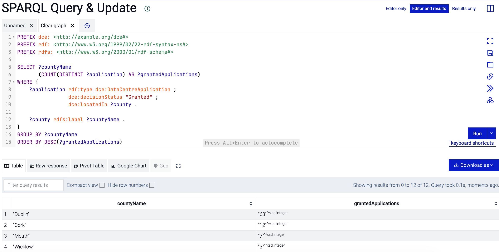
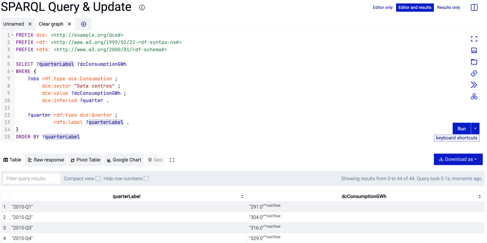
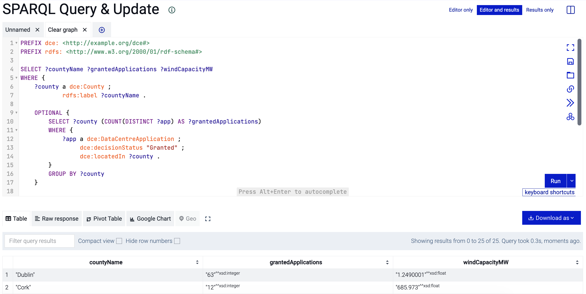
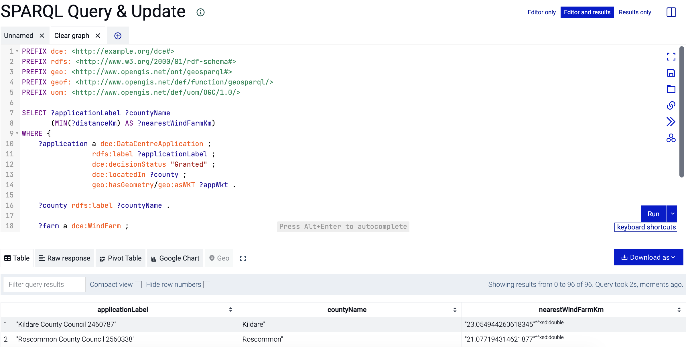
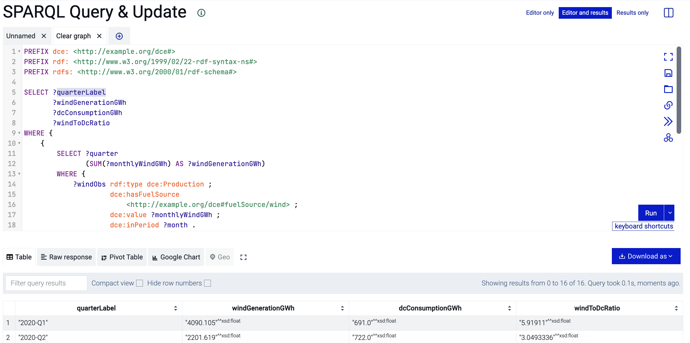
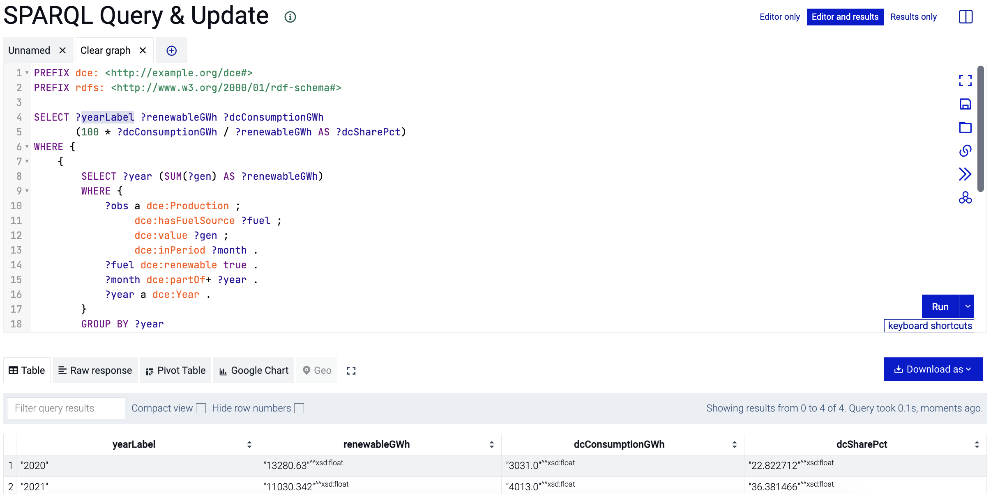
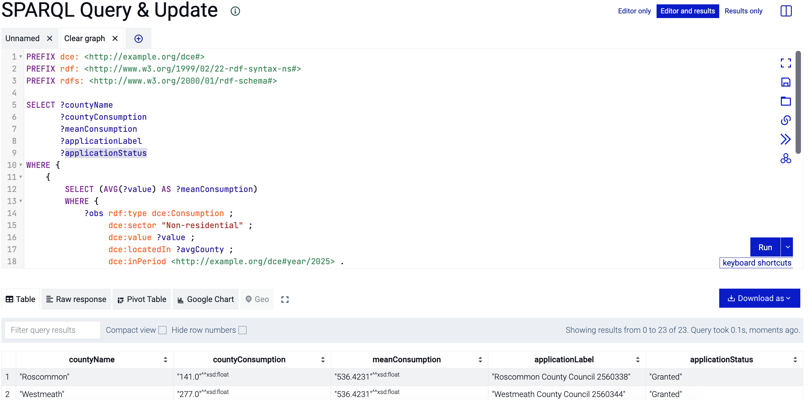

# SPARQL Queries

Seven competency questions for the Data Centre Energy in Ireland knowledge graph, each answered by one SPARQL query. A GraphDB screenshot of each query running is included as `q1.png` to `q7.png` in the `ss_queries/` folder.

---

## Query 1: Granted applications by county

This query asks: "Which counties have the most granted data-centre planning applications?"

It uses the planning applications dataset, the classes `dce:DataCentreApplication` and `dce:County`, and the properties `dce:decisionStatus`, `dce:locatedIn` and `rdfs:label`.

```sparql
PREFIX dce: <http://example.org/dce#>
PREFIX rdf: <http://www.w3.org/1999/02/22-rdf-syntax-ns#>
PREFIX rdfs: <http://www.w3.org/2000/01/rdf-schema#>

SELECT ?countyName
       (COUNT(DISTINCT ?application) AS ?grantedApplications)
WHERE {
    ?application rdf:type dce:DataCentreApplication ;
                 dce:decisionStatus "Granted" ;
                 dce:locatedIn ?county .

    ?county rdfs:label ?countyName .
}
GROUP BY ?countyName
ORDER BY DESC(?grantedApplications)
```



---

## Query 2: Quarterly data-centre consumption

This query asks: "How much electricity did data centres consume in each quarter?"

It uses the MEC02 dataset, the classes `dce:Consumption` and `dce:Quarter`, and the properties `dce:sector`, `dce:value`, `dce:inPeriod` and `rdfs:label`.

```sparql
PREFIX dce: <http://example.org/dce#>
PREFIX rdf: <http://www.w3.org/1999/02/22-rdf-syntax-ns#>
PREFIX rdfs: <http://www.w3.org/2000/01/rdf-schema#>

SELECT ?quarterLabel ?dcConsumptionGWh
WHERE {
    ?obs rdf:type dce:Consumption ;
         dce:sector "Data centres" ;
         dce:value ?dcConsumptionGWh ;
         dce:inPeriod ?quarter .

    ?quarter rdf:type dce:Quarter ;
             rdfs:label ?quarterLabel .
}
ORDER BY ?quarterLabel
```



---

## Query 3: Applications and wind capacity by county

This query asks: "Are data-centre applications in the same counties as wind capacity?"

It uses the planning applications and wind farm datasets, the classes `dce:County`, `dce:DataCentreApplication` and `dce:WindFarm`, and the properties `dce:decisionStatus`, `dce:locatedIn`, `dce:exportCapacityMW` and `rdfs:label`. Offshore wind farms are excluded.

```sparql
PREFIX dce: <http://example.org/dce#>
PREFIX rdfs: <http://www.w3.org/2000/01/rdf-schema#>

SELECT ?countyName ?grantedApplications ?windCapacityMW
WHERE {
    ?county a dce:County ;
            rdfs:label ?countyName .

    OPTIONAL {
        SELECT ?county (COUNT(DISTINCT ?app) AS ?grantedApplications)
        WHERE {
            ?app a dce:DataCentreApplication ;
                 dce:decisionStatus "Granted" ;
                 dce:locatedIn ?county .
        }
        GROUP BY ?county
    }

    OPTIONAL {
        SELECT ?county (SUM(?mw) AS ?windCapacityMW)
        WHERE {
            ?farm a dce:WindFarm ;
                  dce:exportCapacityMW ?mw ;
                  dce:locatedIn ?county .
        }
        GROUP BY ?county
    }

    FILTER(BOUND(?grantedApplications) || BOUND(?windCapacityMW))
    FILTER(LCASE(STR(?countyName)) != "offshore")
}
ORDER BY DESC(?grantedApplications)
```



---

## Query 4: Nearest wind farm

This query asks: "How far is each granted data-centre application from the nearest wind farm?"

It uses the planning applications and wind farm datasets, the classes `dce:DataCentreApplication`, `dce:WindFarm` and `dce:County`, the properties `dce:decisionStatus`, `dce:locatedIn`, `rdfs:label`, `geo:hasGeometry` and `geo:asWKT`, and the GeoSPARQL function `geof:distance`. Wind farm points mark the connecting substation, not the turbines.

```sparql
PREFIX dce: <http://example.org/dce#>
PREFIX rdfs: <http://www.w3.org/2000/01/rdf-schema#>
PREFIX geo: <http://www.opengis.net/ont/geosparql#>
PREFIX geof: <http://www.opengis.net/def/function/geosparql/>
PREFIX uom: <http://www.opengis.net/def/uom/OGC/1.0/>

SELECT ?applicationLabel ?countyName
       (MIN(?distanceKm) AS ?nearestWindFarmKm)
WHERE {
    ?application a dce:DataCentreApplication ;
                 rdfs:label ?applicationLabel ;
                 dce:decisionStatus "Granted" ;
                 dce:locatedIn ?county ;
                 geo:hasGeometry/geo:asWKT ?appWkt .

    ?county rdfs:label ?countyName .

    ?farm a dce:WindFarm ;
          geo:hasGeometry/geo:asWKT ?farmWkt .

    BIND(geof:distance(?appWkt, ?farmWkt, uom:metre) / 1000
         AS ?distanceKm)
}
GROUP BY ?applicationLabel ?countyName
ORDER BY DESC(?nearestWindFarmKm)
```



---

## Query 5: Wind vs data-centre consumption

This query asks: "How does national wind generation compare with data-centre consumption each quarter?"

It uses the MEG02 and MEC02 datasets, the classes `dce:Production`, `dce:Consumption` and `dce:Quarter`, and the properties `dce:hasFuelSource`, `dce:inPeriod`, `dce:partOf`, `dce:sector`, `dce:value` and `rdfs:label`. Monthly wind generation is summed into quarters through `dce:partOf`. The comparison is between national totals and does not show that wind farms supply data centres.

```sparql
PREFIX dce: <http://example.org/dce#>
PREFIX rdf: <http://www.w3.org/1999/02/22-rdf-syntax-ns#>
PREFIX rdfs: <http://www.w3.org/2000/01/rdf-schema#>

SELECT ?quarterLabel
       ?windGenerationGWh
       ?dcConsumptionGWh
       ?windToDcRatio
WHERE {
    {
        SELECT ?quarter
               (SUM(?monthlyWindGWh) AS ?windGenerationGWh)
        WHERE {
            ?windObs rdf:type dce:Production ;
                     dce:hasFuelSource
                         <http://example.org/dce#fuelSource/wind> ;
                     dce:value ?monthlyWindGWh ;
                     dce:inPeriod ?month .

            ?month dce:partOf ?quarter .
        }
        GROUP BY ?quarter
    }

    ?dcObs rdf:type dce:Consumption ;
           dce:sector "Data centres" ;
           dce:value ?dcConsumptionGWh ;
           dce:inPeriod ?quarter .

    ?quarter rdf:type dce:Quarter ;
             rdfs:label ?quarterLabel .

    FILTER(?dcConsumptionGWh > 0)

    BIND(?windGenerationGWh / ?dcConsumptionGWh AS ?windToDcRatio)
}
ORDER BY ?quarterLabel
```



---

## Query 6: Share of renewable generation

This query asks: "What share of renewable generation would data-centre consumption use each year?"

It uses the MEG02 and MEC02 datasets, the classes `dce:Production`, `dce:Consumption`, `dce:Quarter` and `dce:Year`, and the properties `dce:hasFuelSource`, `dce:renewable`, `dce:inPeriod`, `dce:partOf`, `dce:sector`, `dce:value` and `rdfs:label`. Months and quarters are rolled up to years through `dce:partOf`, and incomplete years are excluded.

```sparql
PREFIX dce: <http://example.org/dce#>
PREFIX rdfs: <http://www.w3.org/2000/01/rdf-schema#>

SELECT ?yearLabel ?renewableGWh ?dcConsumptionGWh
       (100 * ?dcConsumptionGWh / ?renewableGWh AS ?dcSharePct)
WHERE {
    {
        SELECT ?year (SUM(?gen) AS ?renewableGWh)
        WHERE {
            ?obs a dce:Production ;
                 dce:hasFuelSource ?fuel ;
                 dce:value ?gen ;
                 dce:inPeriod ?month .
            ?fuel dce:renewable true .
            ?month dce:partOf+ ?year .
            ?year a dce:Year .
        }
        GROUP BY ?year
        HAVING (COUNT(DISTINCT ?month) = 12)
    }
    {
        SELECT ?year (SUM(?dc) AS ?dcConsumptionGWh)
        WHERE {
            ?dcObs a dce:Consumption ;
                   dce:sector "Data centres" ;
                   dce:value ?dc ;
                   dce:inPeriod ?quarter .
            ?quarter a dce:Quarter ;
                     dce:partOf ?year .
            ?year a dce:Year .
        }
        GROUP BY ?year
        HAVING (COUNT(DISTINCT ?quarter) = 4)
    }
    ?year rdfs:label ?yearLabel .
}
ORDER BY ?yearLabel
```



---

## Query 7: Below-average counties

This query asks: "Which counties with data-centre applications have below-average non-residential electricity consumption, and what was decided on those applications?"

It uses the planning applications and MEC03 datasets, the classes `dce:DataCentreApplication`, `dce:Consumption` and `dce:County`, and the properties `dce:locatedIn`, `dce:decisionStatus`, `dce:sector`, `dce:value`, `dce:inPeriod` and `rdfs:label`. The average is calculated over county-level non-residential consumption in 2025.

```sparql
PREFIX dce: <http://example.org/dce#>
PREFIX rdf: <http://www.w3.org/1999/02/22-rdf-syntax-ns#>
PREFIX rdfs: <http://www.w3.org/2000/01/rdf-schema#>

SELECT ?countyName
       ?countyConsumption
       ?meanConsumption
       ?applicationLabel
       ?applicationStatus
WHERE {
    {
        SELECT (AVG(?value) AS ?meanConsumption)
        WHERE {
            ?obs rdf:type dce:Consumption ;
                 dce:sector "Non-residential" ;
                 dce:value ?value ;
                 dce:locatedIn ?avgCounty ;
                 dce:inPeriod <http://example.org/dce#year/2025> .
        }
    }

    ?application rdf:type dce:DataCentreApplication ;
                 rdfs:label ?applicationLabel ;
                 dce:locatedIn ?county ;
                 dce:decisionStatus ?applicationStatus .

    ?consumption rdf:type dce:Consumption ;
                 dce:locatedIn ?county ;
                 dce:sector "Non-residential" ;
                 dce:value ?countyConsumption ;
                 dce:inPeriod <http://example.org/dce#year/2025> .

    ?county rdfs:label ?countyName .

    FILTER(?countyConsumption < ?meanConsumption)
}
ORDER BY ASC(?countyConsumption) ?countyName ?applicationStatus
```


